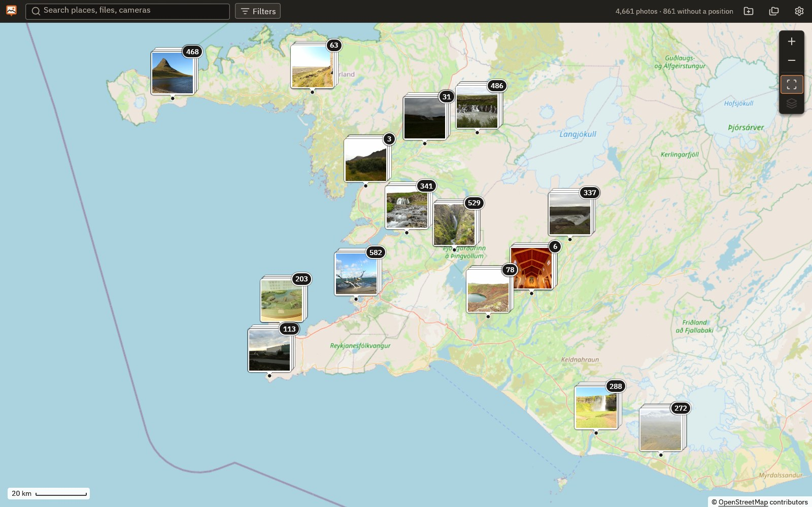
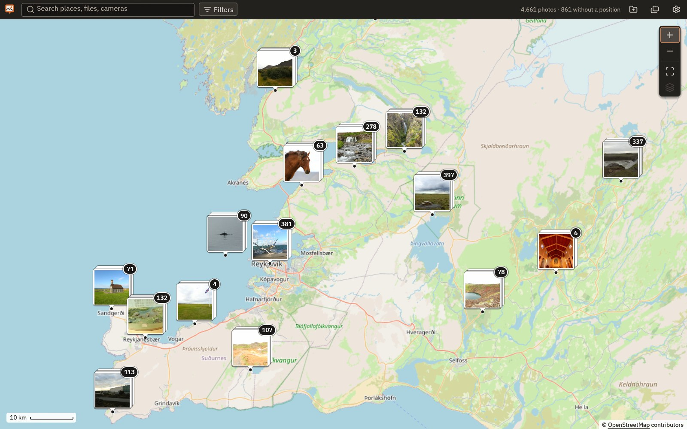
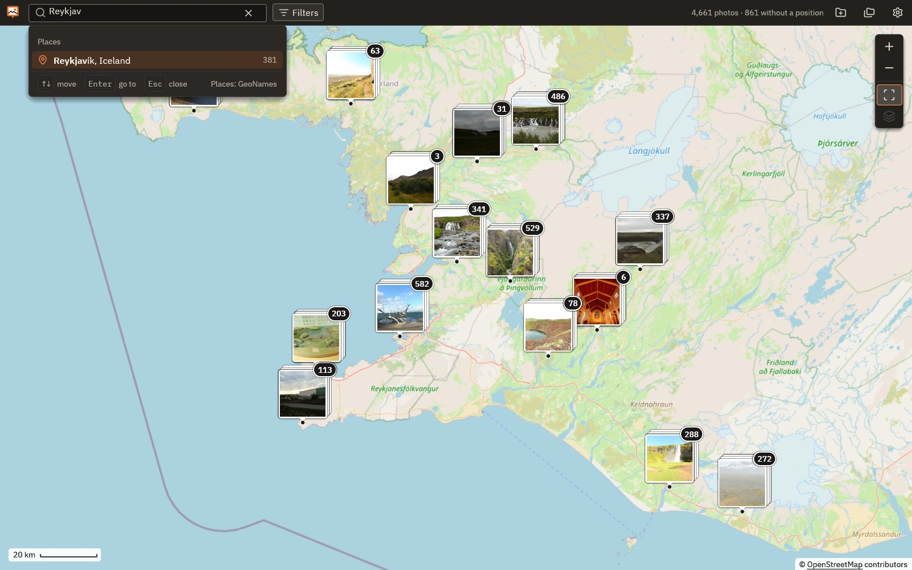
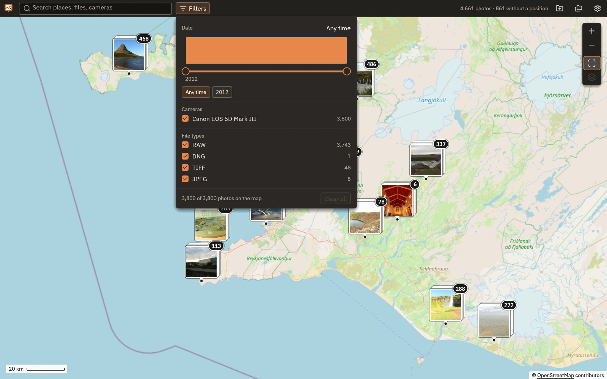

# MapCraft

[](https://github.com/mariokoehler/MapCraft/releases/latest)
[](https://github.com/mariokoehler/MapCraft/actions/workflows/release.yml)
[](#licence)

**Your photos on a world map.** MapCraft is a Windows desktop app that places your photos where
they were taken, like the Map module in Lightroom Classic, without importing them into a
catalogue. It reads the GPS position from each photo, shows thumbnails on an OpenStreetMap map,
and merges nearby photos into groups that split as you zoom in.



- [Features](#features)
- [Screenshots](#screenshots)
- [Download and install](#download-and-install)
- [Getting started](#getting-started)
- [Geotagging from a GPX track](#geotagging-from-a-gpx-track)
- [Updates](#updates)
- [Privacy](#privacy)
- [Companion apps](#companion-apps)
- [Limitations](#limitations)
- [Building from source](#building-from-source)
- [Contributing](#contributing)
- [Licence](#licence)

## Features

- **Your photos stay where they are.** MapCraft only records their paths, on local drives or
  network shares (SMB), and keeps a small thumbnail of each in its own data folder. It never
  copies, moves, renames or writes to your photos. The one exception is geotagging, and only
  when you confirm it: it writes GPS positions into XMP sidecar files next to the photos,
  never into the photos themselves, and can undo that.
- **Thumbnails on the map.** Photos close to each other merge into a group with a count; zoom
  in and the groups split. Click a group to zoom to it, or to see its photos in a strip when
  they were all taken at the same spot.
- **RAW-friendly.** A RAW file and its JPEG count as one photo. Thumbnails come from the RAW's
  embedded preview, so even large libraries are fast to build.
- **GPS from EXIF or XMP sidecars**, for JPEG, TIFF, DNG, CR2, RAF and more.
- **Geotagging from a GPX track**: photos without a position that were taken while a track
  was recorded appear along it; adjust the time shift until they sit where they were taken,
  untick the ones you don't want, and write the positions to XMP sidecars.
- **Search** for places (an offline index of towns and cities from GeoNames, downloaded once on
  request) or for photos by file name, folder, date or camera.
- **Filters** by date (with a histogram), source folder, camera and file type (RAW, DNG, TIFF,
  JPEG, …).
- **Photo details**: file, capture date, camera, lens and position, with *Show in Explorer* and
  *Open*.
- **Companion apps**: open a photo in [PhotoCraft](https://github.com/storytold/photocraft) or
  show it in [LightCraft](https://github.com/storytold/lightcraft) with one click.
- **Rescans** pick up new, changed, moved and missing photos, and folders can be left out.
- **Your data, your disk**: choose where MapCraft keeps its library and thumbnails, see how much
  space each part takes, and free up space when you need it.
- **Updates itself** from GitHub releases, after asking.

## Screenshots

| Groups split as you zoom in | Search for a place |
| --- | --- |
|  |  |

| Filter by date, camera and file type |
| --- |
|  |

## Download and install

MapCraft is a single file, `mapcraft.exe`. There's no installer.

1. **Download** `mapcraft.exe` from the
   [latest release](https://github.com/mariokoehler/MapCraft/releases/latest).
2. **Put it in a folder of your own**, for example `%LOCALAPPDATA%\Programs\MapCraft` (type that
   into Explorer's address bar) or `D:\Apps\MapCraft`.
   - **Not under `C:\Program Files`.** MapCraft updates itself by replacing its own file, and
     Windows doesn't let normal programs change files there. It would still run, but every
     update would have to be downloaded by hand.
   - The folder can be anywhere you can write to: another drive is fine.
3. **Start it.** The exe isn't code-signed, so the first time Windows SmartScreen shows
   *Windows protected your PC*. Click **More info**, then **Run anyway**.
4. Optional: pin it to the taskbar or create a shortcut on the desktop or in the Start menu
   (right-click the exe → *Show more options* → *Send to* / *Pin to Start*).

**Requirements:** Windows 11, 64-bit. Windows 10 (64-bit) should work but isn't tested. An
internet connection for the map tiles.

**Checking the download** (optional): each release also has `mapcraft.exe.sha256`. In
PowerShell, `(Get-FileHash mapcraft.exe).Hash` must match the hash in that file (case doesn't
matter).

**Where MapCraft keeps things:**

| What | Where |
| --- | --- |
| Settings | `%APPDATA%\MapCraft\settings.toml` |
| Library, thumbnails, previews, map tiles, place names | `%LOCALAPPDATA%\MapCraft` by default; change it in *Settings → Data folder* |

**Uninstalling:** delete `mapcraft.exe`, the `%APPDATA%\MapCraft` folder, and the data folder
(shown in *Settings → Data folder*). Your photos aren't affected.

## Getting started

1. Click **Add folder** (the folder icon with a plus, top right) and pick a folder of photos,
   on a local drive or a network share. You can leave out subfolders before importing.
2. MapCraft reads the GPS positions; photos appear on the map as it goes, then thumbnails
   replace the dots.
3. Zoom and pan the map; click a group to zoom in. **F** zooms to all photos, **+** and **−**
   zoom in and out.
4. **Ctrl K** jumps to the search field. **Esc** closes the strip or the selection.
5. Click a photo for its details; **Ctrl I** shows or hides the detail panel.

Photos without a GPS position are counted in the top bar but can't be shown on the map.

## Geotagging from a GPX track

Recorded a walk or a trip with a GPS device or a phone app (Komoot, Garmin, Strava, …)? MapCraft
can place the photos you took without GPS along that track, by their capture time.

1. Click **Tag photos from a GPX track…** (the route icon, top right) and pick one or more
   `.gpx` files. Several files, for example one per day, become one timeline.
2. The track appears on the map with the photos taken during it: those without a position,
   taken within 3 hours of the track (the margin can be changed in the panel).
3. **Set the time shift.** GPX times are in UTC; camera clocks usually show local time and
   drift a little. Pick the photos' time zone and fine-tune the camera clock correction; the
   photos slide along the track as you do. If you know where a photo was taken, select it,
   click **Set from a photo's place…**, then click that spot on the track.
4. **Untick** photos or groups that shouldn't get a position (a tick on each marker, and on
   each photo in a group's strip).
5. Click **Write positions…** and confirm. MapCraft writes the position into each photo's XMP
   sidecar (`IMG_1234.xmp`): an existing sidecar keeps everything else in it, and the photo
   files themselves are never changed.

**Undo** is in the result's message, and under *Last written* the next time you open
geotagging; it restores the sidecars as they were (a sidecar another program changed since is
left alone).

Good to know:

- **The track needs times.** Routes planned on a website usually have none; tracks recorded
  by a device or app do. MapCraft says so when a file has no times.
- **Pauses:** where recording stopped and you stayed put (lunch, a viewpoint), photos taken
  meanwhile get that spot.
- **Lightroom Classic** shows the new positions after *Metadata → Read Metadata from Files*,
  and only for camera RAW files: for JPEG, TIFF and DNG it reads the file's own metadata, not
  the sidecar. **LightCraft** may overwrite the sidecars if it writes its own.
- Try it on a copy of a folder first if you like: the photos' folders must be writable.

## Updates

MapCraft checks GitHub for a newer release when it starts. If there is one, it says so; click
**Update…**, then **Update and restart**. It downloads the new version, checks it against the
release's checksum, replaces itself and starts again. Your library and settings stay as they
are.

- The check can be turned off in *Settings → Updates*, which also has **Check now**.
- If MapCraft's folder isn't writable (see [Download and install](#download-and-install)), it
  offers the release page instead: download the new `mapcraft.exe` and replace the old one.
- A newer version may upgrade the library's format; an older version can't open it afterwards.
  The release notes say when that happens.

## Privacy

Your photos and their locations stay on your computer. MapCraft connects to:

- **OpenStreetMap's tile servers**, to draw the map (the requests show which area you look at,
  not your photos);
- **GitHub**, once per start, to ask for the latest release (it can be turned off);
- **geonames.org**, only when you ask for the place index to be downloaded.

Nothing else is sent anywhere, and the log never contains positions.

## Companion apps

MapCraft doesn't edit photos. It hands them to two open-source apps, if you have them:

- **[PhotoCraft](https://github.com/storytold/photocraft)** opens JPEG, PNG, TIFF, WebP and PSD
  files.
- **[LightCraft](https://github.com/storytold/lightcraft)** finds the photo in its library and
  shows it. MapCraft starts it with remote control on: a local port without a password, which
  other programs on the same computer could use while LightCraft runs.

Their locations are set in *Settings → Companion apps*. MapCraft is not affiliated with the
team that makes them.

## Limitations

- **Windows only.**
- **Photos without GPS** can be placed from a GPX track, but not by hand yet.
- **Videos** aren't imported.
- **HEIC files** and RAW files without an embedded preview get a placeholder instead of a
  thumbnail.
- **The map** uses OpenStreetMap's tiles, so it needs an internet connection; tiles you've seen
  are cached.

See [`design.md`](design.md) for the concept, the architecture, open questions and the roadmap.

## Building from source

You need Rust (via [rustup](https://rustup.rs)) and the Visual Studio Build Tools with the
*Desktop development with C++* workload.

```powershell
git clone https://github.com/mariokoehler/MapCraft.git
cd MapCraft
cargo run            # a debug build, with a console window for the log
cargo run --release  # the optimised build, as released
cargo test           # the unit and headless UI tests
```

More on the project's layout, its development flags and the release process is in
[`CLAUDE.md`](CLAUDE.md) and [`design.md`](design.md).

## Contributing

MapCraft is a personal, non-commercial project, but bug reports and ideas are welcome as
[issues](https://github.com/mariokoehler/MapCraft/issues). Please include the MapCraft version
(*Settings → Updates*) and, for import or thumbnail problems, the file types involved; never
attach photos that show where you live.

Before a pull request: `cargo fmt`, `cargo clippy --all-targets` (warning-free) and
`cargo test`.

## Licence

Licensed under either of

- Apache License, Version 2.0 ([`LICENSE-APACHE`](LICENSE-APACHE) or
  <https://www.apache.org/licenses/LICENSE-2.0>)
- MIT license ([`LICENSE-MIT`](LICENSE-MIT) or <https://opensource.org/licenses/MIT>)

at your option.

Unless you explicitly state otherwise, any contribution intentionally submitted for inclusion in
the work by you, as defined in the Apache-2.0 license, shall be dual licensed as above, without any
additional terms or conditions.

### Third-party material

- Map data © [OpenStreetMap](https://www.openstreetmap.org/copyright) contributors (ODbL). Place
  names from [GeoNames](https://www.geonames.org/) (CC BY 4.0).
- [IBM Plex](https://github.com/IBM/plex) Sans and Mono fonts, © IBM Corp., under the SIL Open
  Font License 1.1 ([`assets/fonts/OFL.txt`](assets/fonts/OFL.txt)).
- [Lucide](https://lucide.dev) icons, © Lucide Icons and Contributors, under the ISC licence
  ([`assets/icons/LICENSE`](assets/icons/LICENSE)).
- The libraries built into the exe, with their licences, are listed in `THIRD-PARTY-NOTICES.txt`
  in each release.
- The screenshots show the author's own photos.
